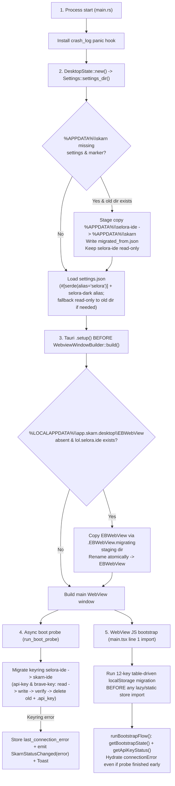

# Card S1-2 — Eight Breaking Migrations & v1.0.0 Identity (Execution Plan — Locked)

> **Status:** Approved & Locked for Pass 2 Execution.
> **Governing Baseline:** Commit `66d8cf5` (`S1-1` mechanical rename complete); `S0-1` & `S0-2` complete in `8e47024`.
> **Skill Enforced:** `.agents/skills/skarn-migration-guard/SKILL.md` & `references/identities.md` + Card S1-2 in `docs/SKARN_PHASE0_BRIEF.md`.

---

## Locked Owner Scope & Ground-Truth Decisions

1. **Sidecar path correction:** `crates/skarn-fs/src/` contains `{fuzzy.rs, lib.rs, search.rs, tree.rs}` and **no `fs.rs`**. The agent backup/temp sidecars (`..<name>.selora-bak` and `..<name>.selora-tmp-<pid>-<seq>`) live at `crates/skarn-ai/src/agent/tools/fs.rs:856-885` (paired with `crates/skarn-ai/src/agent/router.rs:310` and temp siblings in `apps/skarn-desktop/src-tauri/src/workspace.rs:1409` and `crates/skarn-settings/src/settings.rs:697`).
2. **Protocol status wire tag:** Rename `#[serde(rename = "selora_status_changed")]` -> `"skarn_status_changed"` atomically in `crates/skarn-protocol/src/lib.rs:2335`, `apps/skarn-desktop/frontend/src/bridge/bridge.ts:846`, and `apps/skarn-desktop/frontend/src/app/app-store.ts:521` alongside the 5 IPC channels.
3. **Keyring error surfacing & race-proof StatusBar hydration:** Fix `crates/skarn-settings/src/keyring.rs:171` so non-`NoEntry` errors are never swallowed into `Ok(None)`, and surface a one-line re-entry prompt across `apps/skarn-desktop/frontend/src/app/app-store.ts`, `apps/skarn-desktop/frontend/src/layout/StatusBar.tsx`, and `apps/skarn-desktop/frontend/src/features/auth/ConnectModal.tsx`. `app-store.ts` must hydrate any existing keyring error during initial bootstrap/status fetch (`getApiKeyStatus()`), **not** only from live `skarn_status_changed` events, so `StatusBar.tsx` still displays the prompt if `run_boot_probe` finishes before the WebView listener attaches.
4. **ESM-hoisting-safe 12-key `localStorage` migration:** Five stores (`sound-store.ts`, `onboarding-store.ts`, `local-preferences.ts`, `toast-store.ts`, `agent-store.ts`) read `localStorage` at module evaluation time. Invoke migration via a **line-1 side-effect import** (`import './app/run-storage-migration';`) at the very top of `apps/skarn-desktop/frontend/src/main.tsx` and verify `main.tsx` + `apps/skarn-desktop/frontend/src/app/surface.ts` have zero static transitive imports of any store so ESM hoisting can never run a store before migration.
5. **Out-of-scope boundary & metadata path fix:** Keep workspace-local `.selora/agent-sessions`, `.selora/workflow-runs`, and `selora.*` keymap command IDs out of S1-2; update stale `crates\selora-ai` / `crates\selora-ui` / `installer\selora-ide.iss` paths in `scripts/check-release-metadata.ps1`.
6. **Approved trims:**
   - `crates/skarn-ai/src/updates.rs:157-170`: match strictly `Skarn-Setup-{version}.exe` (and `.sha256`); **no** `"skarn-installer-v1.exe"` fallback.
   - `installer/skarn.iss` `[UninstallDelete]`: mirror `installer/selora-ide.iss:125-130` parity (`{userappdata}\selora-ide` -> `{userappdata}\skarn`, plus `{localappdata}\Skarn` and `{localappdata}\app.skarn.desktop` for Skarn's own updater/WebView2 dirs; never touch `{userappdata}\selora-ide` on install or uninstall).

---

## Boot & Upgrade Sequencing Overview



---

## A. Exact File-by-File Change Manifest (All 8 Migrations)

> **Single-writer & atomic commit rule:** Execute all 8 migrations in **Commit 2 (`S1-2`)** so the 5 IPC channels, `skarn_status_changed` wire tag, settings root key, keyring service, and manifest versions move atomically with zero split-window mismatch.

### 1. Tauri Identity (`app.skarn.desktop`, `"Skarn"`, `1.0.0`, WebView2 Migration)

- **`[MODIFY]` `apps/skarn-desktop/src-tauri/tauri.conf.json`** (`:3-17`)
  - `"productName": "Skarn"`, `"version": "1.0.0"`, `"identifier": "app.skarn.desktop"`, `app.windows[0].title`: `"Skarn"`.
- **`[MODIFY]` `Cargo.toml`** (`:20`)
  - `[workspace.package] version = "1.0.0"`.
- **`[MODIFY]` `apps/skarn-desktop/frontend/package.json`** (`:4`) & **`package-lock.json`** (`:3,9`)
  - `"version": "1.0.0"` in root package metadata.
- **`[MODIFY]` `apps/skarn-desktop/src-tauri/src/main.rs`** (`:48-221`)
  - `:48`: Close prompt `"Save all changes before closing Skarn?"`
  - `:94`: Update doc comment to `%APPDATA%\skarn\logs\skarn.log`
  - `:175-183`: Inside `.setup()`, **before** `WebviewWindowBuilder::new(app, "main", ...)`, resolve `app.path().app_local_data_dir()` (`%LOCALAPPDATA%\app.skarn.desktop`) and call `migrate_webview2_data_dir(&legacy_dir, &new_dir)` (`// skarn-v1-migration-compat` on `"lol.selora.ide"`).
    - **Atomic WebView2 copy rule:** Run only if `!new_dir.join("EBWebView").exists()` and `old_dir.join("EBWebView").is_dir()`. Clean any leftover `new_dir.join(".EBWebView.migrating")`, recursively copy `old_dir/EBWebView` into `new_dir/.EBWebView.migrating`, write `new_dir/.migrated_from_webview` marker (`{"migrated_from":"lol.selora.ide",...}`), and atomically rename `.EBWebView.migrating` -> `EBWebView`. On copy failure, clean staging dir, log via `log_boot`, and continue boot cleanly.
  - `:183`: `.title("Skarn")`
  - `:221`: `.name("skarn-hot-exit-timer".into())` (and `apps/skarn-desktop/src-tauri/src/state.rs:181` `"skarn-hot-exit"`).
- **`[MODIFY]` `apps/skarn-desktop/src-tauri/src/agents_window.rs`** (`:368`)
  - `.title("Skarn Agents")`.
- **`[MODIFY]` `apps/skarn-desktop/frontend/index.html`** (`:1`) & **`apps/skarn-desktop/frontend/src/main.tsx`** (`:33`)
  - `<title>Skarn</title>` and fallback `"Loading Skarn…"`.
- **`[MODIFY]` `crates/skarn-app/src/main.rs`** (`:52,59`) & **`crates/skarn-ui/src/empty_state.rs`** (`:48`)
  - Align `"Selora IDE"` titles -> `"Skarn"`.

---

### 2. Installer (`installer/selora-ide.iss` -> `installer/skarn.iss`)

- **`[RENAME]`** `git mv installer/selora-ide.iss installer/skarn.iss`
- **`[RENAME]`** `git mv assets/icons/selora-ide.ico assets/icons/skarn.ico` (update `assets/icons/generate_icons.py` / `assets/icons/NOTE.md` references to `skarn.ico` / `skarn-256.png` / `skarn-512.png`).
- **`[MODIFY]` `installer/skarn.iss`** (mapped from `installer/selora-ide.iss`):
  - `:35`: `#define MyAppExe MyTargetDir + '\skarn-desktop.exe'`
  - `:47`: **KEEP** `AppId={{7A3E9C41-5D2B-4E8F-B6A1-9C0D2E4F6A8B}` unchanged for in-place `0.1.0 -> 1.0.0` upgrade (single uninstall entry).
  - `:54`: **KEEP** `DefaultDirName={localappdata}\Programs\Selora IDE` for v1.0 (`; skarn-v1-migration-compat` — folder move deferred to v1.1 with `[InstallDelete]`).
  - `:48-50,74,77-79`: `AppName=Skarn`, `AppVerName=Skarn {#MyAppVersion}`, `AppPublisher=codeREDxbt`, `OutputBaseFilename=Skarn-Setup-{#MyAppVersion}`, `SetupIconFile={#SourcePath}..\assets\icons\skarn.ico`, `UninstallDisplayIcon={app}\skarn.ico`, `UninstallDisplayName=Skarn`.
  - `[Files]`: ship `skarn-desktop.exe` and `assets\icons\skarn.ico`.
  - `[Icons]`: `{userappdata}\Microsoft\Windows\Start Menu\Programs\Skarn.lnk` -> `{app}\skarn-desktop.exe`, `{app}\skarn.ico`, `Comment: "Skarn"`.
  - `[Run]`: `{app}\skarn-desktop.exe`, `Description: "{cm:LaunchProgram,Skarn}"`.
  - `[InstallDelete]`: remove orphaned v0.1.0 payloads on upgrade (`; skarn-v1-migration-compat`):
    - `Type: files; Name: "{app}\selora-desktop.exe"`
    - `Type: files; Name: "{app}\selora-ide.ico"`
    - `Type: files; Name: "{userappdata}\Microsoft\Windows\Start Menu\Programs\Selora IDE.lnk"`
  - `[UninstallDelete]` (parity with `installer/selora-ide.iss:130`):
    - `Type: filesandordirs; Name: "{userappdata}\skarn"` (replacing `{userappdata}\selora-ide`; never deletes `{userappdata}\selora-ide`)
    - `Type: filesandordirs; Name: "{localappdata}\Skarn"` (updater staging `%LOCALAPPDATA%\Skarn\updates`)
    - `Type: filesandordirs; Name: "{localappdata}\app.skarn.desktop"` (WebView2 profile)
  - `[Registry]`: replace `SeloraIDE.txt` ProgId with `Skarn.txt` (`DefaultIcon`: `{app}\skarn.ico`, `command`: `"{app}\skarn-desktop.exe" "%1"`). In `[Code] CurStepChanged(ssPostInstall)`, delete obsolete HKCU `SeloraIDE.txt` ProgId value/key (`; skarn-v1-migration-compat`).
  - `[Code]`: rename helper prefixes `Selora*` -> `Skarn*` and error message strings `"Selora IDE"` / `"selora-desktop.exe"` -> `"Skarn"` / `"skarn-desktop.exe"`.
- **`[MODIFY]` `installer/prebuild.bat`**
  - Target `skarn-desktop.exe` (`:79,84-85,273-274`), `installer\skarn.iss` (`:120-121,210`), `Skarn-Setup-%VERSION%.exe` (`:112,272`), SHA-256 regex `^[0-9a-f]{64}  Skarn-Setup-\d+\.\d+\.\d+\.exe$` (`:142`), and `SKARN_*` internal batch vars (`SKARN_ISCC` / `SKARN_SETUP*` / `SKARN_DUMPBIN` / `SKARN_WEBVIEW2_OUT` / `skarn-crt-dlls-*.txt`).
- **`[MODIFY]` `installer/find-iscc.ps1`** (`:12-148`)
  - Check `$env:SKARN_ISCC` first, then `$env:SELORA_ISCC` with warning (`# skarn-v1-migration-compat`).
- **`[MODIFY]` `scripts/check-release-metadata.ps1`** (`:215-302`)
  - Update `'installer\selora-ide.iss'` -> `'installer\skarn.iss'`, `'crates\selora-ai\src\updates.rs'` -> `'crates\skarn-ai\src\updates.rs'`, `'crates\skarn-ui\src\dialogs\about.rs'` -> `'crates\skarn-ui\src\dialogs\about.rs'`.
- **`[MODIFY]` `.github/workflows/ci.yml`** & **`.github/workflows/release.yml`**
  - `ci.yml`: comments -> `skarn.iss`, boot probe path `:170,184` -> `skarn_boot.log`.
  - `release.yml`: `installer\skarn.iss`, `Skarn-Setup-$env:VERSION.exe`, regex `^[0-9a-f]{64}  Skarn-Setup-\d+\.\d+\.\d+\.exe$`, artifact name `skarn-setup-...`, signing description `'Skarn'` / `'Skarn Installer'`, temp `.pfx` -> `skarn-signing.pfx`, draft title `Skarn v...`, verify dir `skarn-draft-verify`.
- **`[MODIFY]` `crates/skarn-ai/src/updates.rs`** (`:150-170,402-467`)
  - Match **strictly** `format!("Skarn-Setup-{version}.exe")` and `format!("{installer_name}.sha256")` — **no** legacy or `"*-installer-v1.exe"` fallback.
  - Update fixture asset names at `:402-437,467` to `Skarn-Setup-1.0.0.exe` and replace `a_release_exposes_the_fixed_installer_name` (`:440-461`) with a negative test proving unrecognized / legacy installer asset names yield `info.installer.is_none()`.
- **`[MODIFY]` `SIGNING.md`, `LICENSE`, `README.md`, `CHANGELOG.md`**
  - `LICENSE`: keep `Copyright (c) 2026 Toxic`, add `Copyright (c) 2026 codeREDxbt`.
  - `CHANGELOG.md`: add `## [1.0.0]` entry (*"Renamed from Selora IDE to Skarn..."*).
  - `README.md`: update product name, installer (`Skarn-Setup-1.0.0.exe`), build paths (`apps/skarn-desktop/frontend`, `skarn-desktop`), and add `"This project began as Selora IDE."` attribution line.

---

### 3. Settings Directory, JSON Root Key Alias & Theme ID

- **`[MODIFY]` `crates/skarn-settings/src/settings.rs`**
  - `:19`: `pub const CONFIG_DIR: &str = "skarn";`
  - Add `pub const LEGACY_CONFIG_DIR: &str = "selora-ide"; // skarn-v1-migration-compat` and `pub const MIGRATION_MARKER_FILE: &str = "migrated_from.json";`.
  - `:28`: `pub const SETTINGS_DIR_ENV: &str = "SKARN_SETTINGS_DIR";` and `pub const LEGACY_SETTINGS_DIR_ENV: &str = "SELORA_SETTINGS_DIR"; // skarn-v1-migration-compat`.
  - `:55`: `fn default_theme() -> String { "skarn-dark".into() }`
  - `:134`: Rename `pub selora: SkarnSettings` ->:
    ```rust
    #[serde(default, alias = "selora")] // skarn-v1-migration-compat
    pub skarn: SkarnSettings,
    ```
    (Serializes strictly as `"skarn"`; accepts `"selora"` on deserialization.)
  - `:697`: `.prefix(".skarn-tmp-")` (update test `:946`).
  - **Settings directory migration + read-only fallback:**
    - Pure testable helper `migrate_legacy_settings_dir(old_dir: &Path, new_dir: &Path) -> Result<bool, SkarnError>`:
      - Skip if `!old_dir.is_dir()` OR `new_dir.join(MIGRATION_MARKER_FILE).exists()` OR `new_dir.join(SETTINGS_FILE_NAME).exists()`.
      - Copy recursively without overwriting any pre-existing files (e.g. early `logs/`) in `new_dir`.
      - Atomically write `new_dir/migrated_from.json`: `{"migrated_from":"selora-ide","migrated_at_unix_secs":<u64>}` (`// skarn-v1-migration-compat`).
      - Leave `old_dir` untouched as a read-only fallback.
    - When neither `SKARN_SETTINGS_DIR` nor `SELORA_SETTINGS_DIR` is set, run migration once via `OnceLock` during settings-dir resolution.
    - In `Settings::load()` (and `DesktopState::new()`), if `new_path` (`%APPDATA%\skarn\settings.json`) is still missing while `%APPDATA%\selora-ide\settings.json` exists, read `%APPDATA%\selora-ide\settings.json` **read-only** without writing back to `selora-ide` (`// skarn-v1-migration-compat`).
- **`[MODIFY]` Settings callers (field `settings.selora` -> `settings.skarn`):**
  - `apps/skarn-desktop/src-tauri/src/state.rs` (`:953,2257,2300-2301,3108,3149-3150,3349,5591,5779,5784,5803,11352,11377`)
  - `apps/skarn-desktop/src-tauri/src/sessions.rs` (`:5411`)
  - `apps/skarn-desktop/src-tauri/src/agents_preferences.rs` (`:101,110,423,434-436,463`)
  - `crates/skarn-app/src/shell.rs` (`:394,401,600,1216,1453,1830,3595,3608`)
  - `crates/skarn-app/src/wiring.rs` (`:923`)
  - `crates/skarn-ui/src/dialogs/settings/skarn_section.rs` (`:132,141`)
- **`[MODIFY]` Theme ID `"selora-dark"` -> `"skarn-dark"` with read alias:**
  - `apps/skarn-desktop/src-tauri/src/state.rs` (`:3222-3237`): in `settings_view(&settings)` map persisted `"selora-dark"` -> `"skarn-dark"` (`// skarn-v1-migration-compat`), and in `apply_settings_update` accept `"skarn-dark"` primary + `"selora-dark"` alias normalized to `"skarn-dark"` (`// skarn-v1-migration-compat`) so writes always persist `"skarn-dark"`. Update assertions `:5720,5785`.
  - `crates/skarn-protocol/src/lib.rs` (`:2577,2685,2707`): update sample/test fixtures to `"skarn-dark"`.
  - `apps/skarn-desktop/frontend/src/features/theme/theme.ts` (`:7-57`):
    - `THEME_VALUES = ['skarn-dark', 'galaxy', 'dark', 'space-black', 'light', 'system'] as const`
    - `DEFAULT_THEME: ThemeValue = 'skarn-dark'`
    - `THEME_OPTIONS`: `{ value: 'skarn-dark', label: 'Skarn Dark' }`, `{ value: 'galaxy', label: 'Skarn Galaxy' }`, `{ value: 'light', label: 'Skarn Daylight (Light)' }`
    - `normalizeThemeValue(value)`: map `'selora-dark'` -> `'skarn-dark'` (`// skarn-v1-migration-compat`); `resolveTheme('selora-dark')` -> `'dark'`.
    - Update `theme.test.ts` (`:26-137`) and `SettingsPanelView.appearance.test.tsx` (`:33`).
  - `crates/skarn-ui/src/dialogs/settings/mod.rs` (`:613-617`): update `"selora-dark"` note -> `"skarn-dark"`.

---

### 4. Windows Credential Manager (`selora-ide` -> `skarn-ide`)

- **`[MODIFY]` `crates/skarn-settings/src/keyring.rs`**
  - `:29`: `pub const SERVICE: &str = "skarn-ide";`
  - Add `pub const LEGACY_SERVICE: &str = "selora-ide"; // skarn-v1-migration-compat`.
  - Extract a testable `CredentialStore` abstraction (`migrate_and_get_in(...)`) covering all failure modes without touching the live Windows vault.
  - **Strict migration sequence** for both `ENTRY` (`"api-key"`) and `BRAVE_ENTRY` (`"brave-key"`):
    1. Read `(new_service, user)`:
       - `Ok(k)` (non-blank): remove plaintext fallback in **both** `new_dir` (`%APPDATA%\skarn`) and `old_dir` (`%APPDATA%\selora-ide`); return `Ok(Some(k))`.
       - `Err(keyring::Error::NoEntry)` (or blank): proceed to step 2.
       - `Err(other_err)`: **do NOT swallow into `Ok(None)`**; check fallback first, else return `Err(SkarnError::Config(...))`.
    2. Read `(old_service, user)`:
       - `Ok(old_k)` (non-blank):
         - Write `new_entry.set_password(&old_k)` -> on failure, abort without deleting old entry or `.api_key`/`.brave_key`.
         - **Verify read-back** `new_entry.get_password() == old_k` -> on mismatch or read error, abort without deleting old entry or plaintext fallback.
         - Delete old entry (`old_entry.delete_credential()`, ignoring `NoEntry`).
         - Delete plaintext `.api_key`/`.brave_key` in **both** `new_dir` and `old_dir`.
         - Log **one secret-free line** (`[skarn-keyring] migrated credential "{user}" from {old_service} to {new_service}`).
         - Return `Ok(Some(old_k))`.
       - `Err(keyring::Error::NoEntry)`: check fallback in `new_dir`, then `old_dir`; if found, restore+verify into `new_service` and delete both fallback files only on verified write.
       - `Err(other_err)`: check fallback; if absent, return `Err(SkarnError::Config(...))` (never silent `Ok(None)`).
  - Expose `pub fn migrate_legacy_credentials()` for boot-time migration of both `ENTRY` and `BRAVE_ENTRY` when `ApiKeySource::Keyring` is active.
- **`[MODIFY]` `apps/skarn-desktop/src-tauri/src/sessions.rs` & `state.rs`**
  - In `run_boot_probe` (production `ApiKeySource::Keyring` only), migrate `BRAVE_ENTRY` alongside `api_key_get()`.
  - When `fetch_api_key()` returns `Err(err)` with `code == "keyring_unavailable"`, `connect_probe` stores `inner.last_connection_error = Some(err.message)`, emits `SkarnStatusChanged(Disconnected, error)`, and emits one `FrontendEvent::Toast(Warning)` (*"Saved API key could not be read from Windows Credential Manager — click Connect to re-enter it."*).
  - Update `sessions.rs:2978` error message `"No API key is stored — connect first."`.
- **`[MODIFY]` `apps/skarn-desktop/frontend/src/app/app-store.ts`, `layout/StatusBar.tsx`, `features/auth/ConnectModal.tsx`**
  - `app-store.ts`: add `connectionError: string | null` on `AppState`. Update it on `skarn_status_changed` (`payload.error ?? null`, cleared when `status === 'connected'`).
  - **Initial-fetch hydration (boot race fix):** Inside `runBootstrapFlow()` and `refreshBootstrap()` (when `isNativeFrontend()`), safely invoke `getApiKeyStatus?.()` alongside bootstrap (wrapped in `Promise.resolve(...).catch(() => null)` so partial Vitest mocks stay green). If `!status.connected && (status.source === 'keyring_error' || status.last_error)`, populate `connectionError` immediately—guaranteeing `StatusBar.tsx` displays the prompt even if `run_boot_probe` completed before `listenProtocolEvent` attached.
  - `StatusBar.tsx`: read `connectionError` from `useSyncExternalStore(subscribeApp, getAppSnapshot)` and, when set while disconnected, render a clickable one-line error button (`"keyring error · re-enter key"` or `"connection error · retry"`) wired to `onOpenConnect`.
  - `ConnectModal.tsx`: when `keyStatus?.source === 'keyring_error'` or `keyStatus?.last_error` is non-empty, show a one-line `connect-alert is-error` prompt (*"Saved key could not be read from Windows Credential Manager — please re-enter your API key."*).

---

### 5. Environment Variable Aliases (`SKARN_*` primary, `SELORA_*` read fallback)

| Primary Env Var | Legacy Alias (`// skarn-v1-migration-compat`) | Sites | Child-Env Stripping |
|---|---|---|---|
| `SKARN_SETTINGS_DIR` | `SELORA_SETTINGS_DIR` | `crates/skarn-settings/src/settings.rs:28`, `scripts/agents-window-smoke.mjs:145`, `scripts/walkthrough.ps1:355` | Excluded by `bash.rs` / `workflows_host.rs` allowlists |
| `SKARN_API_KEY` | `SELORA_API_KEY` | `apps/skarn-desktop/src-tauri/src/sessions.rs:155`, `commands.rs:528-533` | Stripped in `skarn-fs/src/search.rs:434`, `skarn-lsp/src/client.rs:383`, `workflows_host.rs:173`, `bash.rs` |
| `SKARN_WORKSPACE_ROOT` | `SELORA_WORKSPACE_ROOT` | `apps/skarn-desktop/src-tauri/src/state.rs:2151,3984`, `scripts/walkthrough.ps1:354` | Excluded by allowlists |
| `SKARN_ISCC` | `SELORA_ISCC` | `installer/find-iscc.ps1:72` | Build-time only |
| `SKARN_SETUP*` (internal batch) | — (internal to `prebuild.bat`) | `installer/prebuild.bat:139-233` | Build-time only |
| `SKARN_KEY` / `SKARN_BASE_URL` / `SKARN_MODEL` | `SELORA_KEY` / `SELORA_BASE_URL` / `SELORA_MODEL` | `crates/skarn-ai/examples/smoke.rs:16-43` | Example only |

- **Shared Rust fallback helper:** Add `pub fn env_var_with_legacy_fallback(primary: &str, legacy: &str) -> Option<String>` in `skarn_settings` (reused across `settings.rs`, `state.rs`, `sessions.rs`, `commands.rs`). When `primary` is unset/blank and `legacy` is non-empty, log one deduplicated deprecation warning (`// skarn-v1-migration-compat`).
- **Child-process secret stripping (both prefixes blocked):**
  - `crates/skarn-fs/src/search.rs:434`: `const KEY_ENV_VARS: [&str; 3] = ["SKARN_API_KEY", "SELORA_API_KEY", "OPENAI_API_KEY"]; // skarn-v1-migration-compat`
  - `crates/skarn-lsp/src/client.rs:383`: `const KEY_ENV_VARS: [&str; 3] = ["SKARN_API_KEY", "SELORA_API_KEY", "OPENAI_API_KEY"]; // skarn-v1-migration-compat` (+ `:1257-1275` tests)
  - `apps/skarn-desktop/src-tauri/src/workflows_host.rs:173`: `const SECRET_ENV_VARS: [&str; 3] = ["SKARN_API_KEY", "SELORA_API_KEY", "OPENAI_API_KEY"]; // skarn-v1-migration-compat` (+ `:2245-2277` test)
  - `crates/skarn-ai/src/agent/tools/bash.rs:582-645`: extend allowlist/stripping tests to verify zero leakage for **both** `SKARN_*` and `SELORA_*`.

---

### 6. Table-Driven Bootstrap Migration for All 12 `localStorage` Keys

- **`[NEW]` `apps/skarn-desktop/frontend/src/app/storage-migration.ts`**
  - Zero store imports. Exports `STORAGE_KEY_MIGRATIONS` (exact + prefix mappings) and `migrateLegacyLocalStorage(storage?: Storage): number`.
  - Copies `oldKey` -> `newKey` **only when** `storage.getItem(newKey) === null`, preserving parameterized suffixes (`<json>`, `<path>`, `<id>`) byte-for-byte verbatim, leaving old keys readable, and **never** resetting `skarn:onboarding_seen`.
- **`[NEW]` `apps/skarn-desktop/frontend/src/app/run-storage-migration.ts`**
  - Side-effect-only entry (`import { migrateLegacyLocalStorage } from './storage-migration'; migrateLegacyLocalStorage();`) with zero store dependencies.
- **`[MODIFY]` `apps/skarn-desktop/frontend/src/main.tsx`** (`:1-37`)
  - Place `import './app/run-storage-migration';` on **line 1** (before `react`, `@tauri-apps/api/window`, `./app/surface`, and `lazy(() => import(...))`), preventing ESM import hoisting from evaluating any of the 5 eager stores (`sound-store`, `onboarding-store`, `local-preferences`, `toast-store`, `agent-store`) prior to migration. Keep `main.tsx` and `surface.ts` free of static transitive store imports.

| # | Legacy Key (`// skarn-v1-migration-compat`) | Target Key | Owner File | Match Kind |
|---|---|---|---|---|
| 1 | `selora:model_settings` | `skarn:model_settings` | `features/agent/agent-store.ts:133` | Exact |
| 2 | `selora:agent-pinned-sessions` | `skarn:agent-pinned-sessions` | `features/agent/agent-store.ts:134` | Exact |
| 3 | `selora:agent-draft:` | `skarn:agent-draft:` | `features/agent/draft-store.ts:15` | Prefix (preserves JSON `[surface, workspaceId, sessionId]`) |
| 4 | `selora:editor-session:` | `skarn:editor-session:` | `features/editor/editor-persistence.ts:18` | Prefix (preserves normalized/cased `<path>`) |
| 5 | `selora:last-editor-workspace` | `skarn:last-editor-workspace` | `features/editor/editor-persistence.ts:14` | Exact |
| 6 | `selora:editor-preferences` | `skarn:editor-preferences` | `features/editor/local-preferences.ts:2` | Exact |
| 7 | `selora:recent-commands` | `skarn:recent-commands` | `components/CommandPalette.tsx:107,172` | Exact |
| 8 | `selora:agents-workspace:v1:` | `skarn:agents-workspace:v1:` | `features/agents-workspace/agents-workspace-store.ts:41` | Prefix (preserves `<workspaceId \| none>`) |
| 9 | `selora:ui-sounds` | `skarn:ui-sounds` | `features/sound/sound-store.ts:16` | Exact |
| 10 | `selora:notification_history` | `skarn:notification_history` | `features/toasts/toast-store.ts:22` | Exact |
| 11 | `selora:onboarding_seen` | `skarn:onboarding_seen` | `features/onboarding/onboarding-store.ts:8` | Exact |
| 12 | `agents:last-context-tab` | `skarn:agents-last-context-tab` | `features/agents-workspace/AgentsContextPane.tsx:17` | Exact |

- **`[MODIFY]` Existing frontend tests referencing old keys directly:**
  - `features/editor/editor-persistence.test.ts:66-150` (`skarn:editor-session:...`)
  - `features/agents-workspace/agents-workspace-store.test.ts:13-30` (`skarn:agents-workspace:v1:...` and `skarn:layout`)
  - `features/agents-workspace/AgentsContextPane.test.tsx:83` (`skarn:agents-last-context-tab`)

---

### 7. Atomic Single-Commit Rename of All 5 IPC Channels (+ Status Event Tag)

| Legacy Channel | Target Channel | Rust Site(s) | Frontend & Test Site(s) |
|---|---|---|---|
| `selora://event` | `skarn://event` | `src-tauri/src/state.rs:1161,1271,1447`, `sessions.rs:6,2223` | `bridge/bridge.ts:1612` |
| `selora://agent-preferences` | `skarn://agent-preferences` | `src-tauri/src/agents_preferences.rs:161,304` | `bridge/bridge.ts:967` |
| `selora://agents-navigate` | `skarn://agents-navigate` | `src-tauri/src/agents_window.rs:170` | `bridge/bridge.ts:1029`, `bridge/agents-bridge.test.ts:72` |
| `selora://main-session-navigate` | `skarn://main-session-navigate` | `src-tauri/src/agents_window.rs:233` | `bridge/bridge.ts:1033` |
| `selora:update-progress` | `skarn:update-progress` | `src-tauri/src/updates.rs:19` | `bridge/bridge.ts:1590` |
| *(Wire variant tag)* `selora_status_changed` | `skarn_status_changed` | `crates/skarn-protocol/src/lib.rs:2335` | `bridge/bridge.ts:846`, `app/app-store.ts:521` |

- Verify immediately with `node .agents/skills/skarn-migration-guard/scripts/check-ipc-parity.mjs`.

---

### 8. Sidecar Renames (`fs.rs` `selora-bak` -> `skarn-bak`) & `%LOCALAPPDATA%\Skarn` / Log Alignment

- **`[MODIFY]` `crates/skarn-ai/src/agent/tools/fs.rs`** (`:856-885,1629-1758`)
  - `:870` `temp_sibling`: `.<name>.selora-tmp-{pid}-{seq}` -> `.<name>.skarn-tmp-{pid}-{seq}`
  - `:884` `backup_sibling`: `.<name>.selora-bak` -> `.<name>.skarn-bak`
  - Update doc comments and assertions at `:856,873,1629,1640,1686,1695,1714,1758`.
- **`[MODIFY]` `crates/skarn-ai/src/agent/router.rs`** (`:310`)
  - Tool prompt string: ``.<name>.selora-bak`` -> ``.<name>.skarn-bak``.
- **`[MODIFY]` `apps/skarn-desktop/src-tauri/src/workspace.rs`** (`:1409`)
  - Temp file pattern `".{}.selora-{}-{sequence}.tmp"` -> `".{}.skarn-{}-{sequence}.tmp"`.
- **`[MODIFY]` `apps/skarn-desktop/src-tauri/src/crash_log.rs`** (`:31,84,107,311-351`)
  - `LOG_FILE_NAME`: `"selora.log"` -> `"skarn.log"` (update fatal/panic headers and tests).
- **`[MODIFY]` `apps/skarn-desktop/src-tauri/src/updates.rs`** (`:3,70-75,199,276,279`)
  - Staging already uses `%LOCALAPPDATA%\Skarn\updates`; align doc comments and test temp filenames.
- **`[MODIFY]` Scripts & CI log path alignment:**
  - `scripts/perf.ps1:83`, `scripts/walkthrough.ps1:450`, `apps/skarn-desktop/frontend/src/bridge/bridge.ts:971`: `selora_boot.log` -> `skarn_boot.log`.
  - `scripts/agents-window-smoke.mjs:18-178`: `skarn-agents-smoke-...`, `SKARN_SETTINGS_DIR`, `window.__skarnSmoke`.

*(Note: Archive `docs/SKARN_S1_2_PLAN.md` and `docs/SKARN_PHASE0_BRIEF.md` under `docs/research/` before Stage 4/5 `--strict` checks so historical notes remain allowlisted.)*

---

## B. Annotation Discipline (`// skarn-v1-migration-compat`)

In `.agents/skills/skarn-supply-chain-gate/scripts/check-legacy-refs.mjs:83-87`, `--strict` fails on **any** case-insensitive `selora` match outside allowlisted docs/legal files unless the exact line contains `skarn-v1-migration-compat`. Every intentional v1.0 compatibility bridge line **must** carry the exact token on that line (never use `skarn-allow-legacy-fixture` for live compatibility code):

| File | Exact Line(s) Requiring `// skarn-v1-migration-compat` (or `#` / `;`) |
|---|---|
| `apps/skarn-desktop/src-tauri/src/main.rs` | Legacy WebView2 dir constant `"lol.selora.ide"` |
| `installer/skarn.iss` | `; skarn-v1-migration-compat` on `DefaultDirName={localappdata}\Programs\Selora IDE`, `[InstallDelete]` old `.exe`/`.ico`/`.lnk`, and `[Code]` cleanup of `SeloraIDE.txt` |
| `crates/skarn-settings/src/settings.rs` | `LEGACY_CONFIG_DIR = "selora-ide"`, `LEGACY_SETTINGS_DIR_ENV = "SELORA_SETTINGS_DIR"`, `#[serde(default, alias = "selora")]`, `"migrated_from": "selora-ide"` marker literal, and legacy-alias unit tests |
| `crates/skarn-settings/src/keyring.rs` | `LEGACY_SERVICE = "selora-ide"`, legacy fallback path lookup, and migration unit tests |
| `apps/skarn-desktop/src-tauri/src/state.rs` | `SELORA_WORKSPACE_ROOT` fallback literal, `"selora-dark"` theme alias arm, and migration unit tests |
| `apps/skarn-desktop/src-tauri/src/sessions.rs` | `SELORA_API_KEY` fallback literal |
| `apps/skarn-desktop/src-tauri/src/commands.rs` | `SELORA_API_KEY` fallback literal + `"env: SELORA_API_KEY"` source label |
| `crates/skarn-fs/src/search.rs` & `crates/skarn-lsp/src/client.rs` | `"SELORA_API_KEY"` in `KEY_ENV_VARS` (+ stripping tests) |
| `apps/skarn-desktop/src-tauri/src/workflows_host.rs` | `"SELORA_API_KEY"` in `SECRET_ENV_VARS` (+ stripping test) |
| `crates/skarn-ai/src/agent/tools/bash.rs` | `SELORA_*` child-env stripping regression assertions |
| `crates/skarn-ai/src/updates.rs` | Negative test fixture asserting `"selora-installer-v1.exe"` / `"Selora-IDE-Setup-1.0.0.exe"` returns `None` |
| `crates/skarn-ai/examples/smoke.rs` | `SELORA_KEY` / `SELORA_BASE_URL` / `SELORA_MODEL` fallbacks |
| `installer/find-iscc.ps1` | `# skarn-v1-migration-compat` on `$env:SELORA_ISCC` fallback |
| `apps/skarn-desktop/frontend/src/features/theme/theme.ts` & `theme.test.ts` | `'selora-dark'` read alias mapping to `'skarn-dark'` / `'dark'` |
| `apps/skarn-desktop/frontend/src/app/storage-migration.ts` & test | All 11 `selora:*` legacy table entries (and annotate `agents:last-context-tab` consistently) |

---

## C. Automated Test Matrix

### Rust Unit & Integration Tests (`cargo test --workspace --locked`)

| Crate / File | Test Name(s) | Scenario & Asserted Invariants |
|---|---|---|
| `skarn-settings` (`settings.rs`) | `serde_alias_selora_deserializes_and_writes_skarn` | Input JSON with `"selora": {"base_url": "...", "active_model": "m", "disabled_providers": ["ollama"]}` loads into `settings.skarn`; re-saving writes `"skarn"` key and **zero** `"selora"` root key. |
| `skarn-settings` (`settings.rs`) | `settings_dir_migrates_once_and_writes_marker` | Old dir with `settings.json`, `agent-preferences.json`, `hot-exit/`, `.api_key` -> copies tree to new dir, writes `migrated_from.json`, leaves old dir intact; second run is idempotent. |
| `skarn-settings` (`settings.rs`) | `settings_dir_migration_skips_when_old_missing_and_preserves_existing_new` | Missing old dir -> no error, no new dir created. Pre-existing `new_dir/settings.json` -> **not** overwritten by old dir. |
| `skarn-settings` (`settings.rs`) | `settings_load_falls_back_read_only_when_new_missing` | New `settings.json` absent + old `settings.json` present -> loads old values without modifying old dir. |
| `skarn-settings` (`settings.rs`) | `env_override_prefers_skarn_and_falls_back_to_selora` | `SKARN_SETTINGS_DIR` wins over `SELORA_SETTINGS_DIR`; `SELORA_SETTINGS_DIR` alone resolves and triggers deprecation path. |
| `skarn-settings` (`keyring.rs`) | `keyring_migration_copies_verifies_deletes_old_and_cleans_plaintext` | Using in-memory/mock backend: `old_service` has secret + both dirs have `.api_key` -> `new_service` written, verified via read-back, `old_service` deleted, **both** `.api_key` files deleted. |
| `skarn-settings` (`keyring.rs`) | `keyring_migration_aborts_on_write_or_verify_failure_without_data_loss` | Simulated write error or read-back mismatch -> returns `Err(SkarnError::Config)`, **retains** `old_service` entry and `.api_key` fallback intact. |
| `skarn-settings` (`keyring.rs`) | `keyring_read_error_surfaces_instead_of_returning_none` | Non-`NoEntry` error (corrupt/locked store) with no `.api_key` -> returns `Err`, **never** `Ok(None)`. |
| `skarn-desktop` (`main.rs` / `state.rs`) | `webview2_migration_copies_ebwebview_atomically_and_ignores_missing_old` | Tempdir test: copies `old/EBWebView` via `.EBWebView.migrating` -> `EBWebView`; missing `old` is no-op; existing `new/EBWebView` is never overwritten. |
| `skarn-desktop` (`state.rs`) | `theme_migration_accepts_selora_dark_alias_and_normalizes_to_skarn_dark` | `Settings` with `"selora-dark"` surfaces `"skarn-dark"` in `settings_view`; `SettingsUpdate` accepts `"selora-dark"` and writes `"skarn-dark"`. |
| `skarn-desktop` (`sessions.rs` / `commands.rs`) | `api_key_env_prefers_skarn_over_selora_and_reports_keyring_error` | `SKARN_API_KEY` wins over `SELORA_API_KEY`; `SELORA_API_KEY` works as fallback; `keyring_unavailable` populates `last_connection_error` & `"keyring_error"` status. |
| `skarn-ai`, `skarn-fs`, `skarn-lsp`, `skarn-desktop` | `bash.rs`, `search.rs`, `client.rs`, `workflows_host.rs` env tests | Setting both `SKARN_API_KEY` and `SELORA_API_KEY` in parent process yields **zero** `SKARN_*` or `SELORA_*` variables in child `bash`, `rg`, LSP, or `world.run` envs. |
| `skarn-ai` (`fs.rs` & `updates.rs`) | `write_atomic_keeps_previous_content_in_a_sidecar` & `updates::tests` | Verifies `.<name>.skarn-bak` and `.<name>.skarn-tmp-*`; `updates.rs` matches **strictly** `Skarn-Setup-<version>.exe` + `.sha256` and rejects legacy/fallback asset names. |

### Frontend Vitest Suite (`npm --prefix apps/skarn-desktop/frontend test`)

| Test File | Test Cases | Asserted Invariants |
|---|---|---|
| `[NEW] storage-migration.test.ts` | Migrates all 12 keys cleanly | Seeds all 12 legacy keys (including parameterized `selora:agent-draft:["main","ws1","s1"]`, Windows & POSIX `selora:editor-session:c:/Work/Repo`, and `selora:agents-workspace:v1:ws_abc`, plus `agents:last-context-tab`); asserts exact verbatim copy to `skarn:*`, **`skarn:onboarding_seen === 'true'` retained**, and legacy keys untouched. |
| `[NEW] storage-migration.test.ts` | Does not overwrite existing `skarn:*` keys & is idempotent | Pre-populates `skarn:model_settings` and `skarn:onboarding_seen` alongside differing `selora:*` values; asserts `skarn:*` values win and re-running returns `0` changes. |
| `[NEW] storage-migration.test.ts` | Parameterized suffix edge cases & storage exceptions | Paths with colons/mixed-case/JSON punctuation keep exact suffix; throwing `localStorage` stub degrades without throwing during boot. |
| `[NEW] storage-migration.test.ts` | Boot ordering & ESM hoisting proof | Seeds `selora:onboarding_seen = 'true'` and `selora:ui-sounds = 'true'` -> imports `run-storage-migration.ts` -> dynamically imports `onboarding-store` & `sound-store` -> asserts `onboardingStore.shouldShow() === false` and `getSoundSnapshot() === true`; also verifies `main.tsx` line-1 import and `surface.ts` imports. |
| `theme.test.ts` & `SettingsPanelView.appearance.test.tsx` | Theme alias & default | `DEFAULT_THEME === 'skarn-dark'`; `resolveTheme('selora-dark') === 'dark'`; `normalizeThemeValue('selora-dark') === 'skarn-dark'`. |
| `agents-bridge.test.ts` (+ channel/status assertions) | All 5 IPC channels + `skarn_status_changed` | Verifies `skarn://agents-navigate`, `skarn://main-session-navigate`, `skarn://agent-preferences`, `skarn://event`, `skarn:update-progress`, and `skarn_status_changed` in `app-store.ts`. |
| `ConnectModal` / `StatusBar` / `app-store` test | Keyring failure 1-line UX prompt + early boot hydration | `getApiKeyStatus` returning `{ source: 'keyring_error', last_error: '...' }` hydrates `connectionError` even without a live `skarn_status_changed` event, rendering the actionable re-entry prompt in `StatusBar` and `ConnectModal`. |

### Gate Verification Commands (Run After Pass 2 Edits)

1. `node .agents/skills/skarn-migration-guard/scripts/check-ipc-parity.mjs` -> exit `0`
2. `node .agents/skills/skarn-supply-chain-gate/scripts/check-legacy-refs.mjs` -> exit `0` (`0` P0 hits)
3. `node .agents/skills/skarn-supply-chain-gate/scripts/check-legacy-refs.mjs --strict` -> zero unannotated `selora` hits in modified/runtime paths
4. `powershell -NoProfile -ExecutionPolicy Bypass -File scripts\check-release-metadata.ps1 -RequireChangelog` -> exit `0`
5. `cargo test --workspace --locked` -> all pass
6. `npm --prefix apps/skarn-desktop/frontend run typecheck && npm --prefix apps/skarn-desktop/frontend test && npm --prefix apps/skarn-desktop/frontend run build` -> all pass

---

## D. Top 3 Silent-Data-Loss Failure Modes & How This Plan Prevents Them

1. **WebView2 `EBWebView` Orphaned Behind `lol.selora.ide` (or ESM-Hoisted Store Reads) -> All 12 `localStorage` Keys Vanish**
   - *How it happens here:* Tauri v2 binds WebView2's `user_data_folder` (`EBWebView\Default\Local Storage\leveldb`) to `%LOCALAPPDATA%\<identifier>`. Switching `identifier` from `lol.selora.ide` to `app.skarn.desktop` points WebView2 at an empty profile; additionally, 5 stores (`sound-store`, `onboarding-store`, `local-preferences`, `toast-store`, `agent-store`) read `localStorage` at module evaluation time, so ESM hoisting would evaluate them before a late migration call.
   - *How this plan prevents it:* In `main.rs` `.setup()` **before** `WebviewWindowBuilder::build()`, check `!new_dir.join("EBWebView").exists() && old_dir.join("EBWebView").is_dir()`, copy into `.EBWebView.migrating`, and atomically rename to `EBWebView`. Then execute `migrateLegacyLocalStorage()` via `import './app/run-storage-migration';` on **line 1** of `main.tsx` with zero static transitive store imports in `main.tsx` or `surface.ts`.

2. **Missing `#[serde(alias = "selora")]` or Partial Settings Dir Creation -> Silent Profile Reset**
   - *How it happens here:* `Settings` uses `#[serde(default)]` on every root section (`settings.rs:118-159`). When `pub selora` becomes `pub skarn`, `serde_json` silently ignores `"selora"` and resets `base_url`, `active_model`, and `disabled_providers` on next save. Likewise, early creation of `%APPDATA%\skarn\logs\` would cause a naive `!new_dir.exists()` check to skip copying `settings.json`, `hot-exit/`, and `agent-preferences.json`.
   - *How this plan prevents it:* Add `#[serde(default, alias = "selora")]` on `pub skarn: SkarnSettings` (serialize strictly as `"skarn"`), gate directory migration on `!new_dir.join("settings.json").exists() && !new_dir.join("migrated_from.json").exists()`, write `migrated_from.json`, retain `%APPDATA%\selora-ide` as a read-only fallback, and alias `"selora-dark"` -> `"skarn-dark"`.

3. **Premature Delete, Swallowed Read Error, or Missed Boot Event in Keyring Migration -> Key Loss or Silent Disconnect**
   - *How it happens here:* `keyring.rs:171` catches non-`NoEntry` errors under `_ =>` and returns `Ok(None)` when `.api_key` is absent, while `app-store.ts:521` drops `SkarnStatusChanged.error` and `ConnectModal.tsx` ignores `source === 'keyring_error'`. Also, `run_boot_probe` can finish before `listenProtocolEvent` attaches. Deleting `"selora-ide"` or `.api_key` before read-back verification would permanently destroy credentials on a transient vault failure.
   - *How this plan prevents it:* Enforce **read old -> write new -> verify read-back equality -> delete old -> delete `.api_key`/`.brave_key` in both dirs**; abort with `Err` (preserving old credentials and `.api_key`) on any write/verify failure; propagate non-`NoEntry` errors; and hydrate `connectionError` in `app-store.ts` from **both** `skarn_status_changed` and initial `getApiKeyStatus()` so `StatusBar.tsx` and `ConnectModal.tsx` always render the one-line re-entry prompt.
