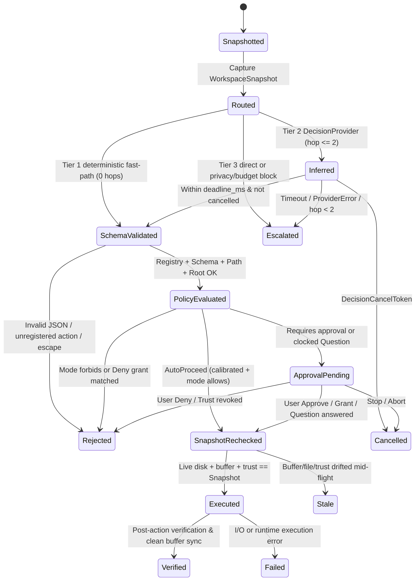

# Stage 3 Execution Plan — Decision Engine Core & Unified Trust Layer (`S3-1` + `S3-2`)

> **Status:** Approved & Locked (Pass 1 Design Sign-Off Complete).
> **Governing Baseline:** Commit `0e70313` (Stage 2 complete; Stage 0 & Stage 1 complete).
> **Skills & Contracts Enforced:** [SKILL.md](../.agents/skills/skarn-decision-invariants/SKILL.md), [decision-contract.md](../.agents/skills/skarn-decision-invariants/references/decision-contract.md), [SKARN_MASTER_BLUEPRINT.md](../SKARN_MASTER_BLUEPRINT.md), and [SKARN_PHASE0_BRIEF.md](SKARN_PHASE0_BRIEF.md).

---

## Locked Owner Decisions & Tightening Rules

### Locked Decisions
1. **Checkpoint Storage:** Store content-addressed before/after blobs under `%APPDATA%\skarn\checkpoints\<workspace_id>\<session_id>\<turn_id>` (never inside the user's Git workspace).
2. **Minimal Decision Trace Inspector (`S3-2`):** Render a collapsible trace drawer on `ToolCard` plus a session trace popover in `AgentConversationSurface`, preserving Stage 2's `BottomDock` (`Problems | Terminal`) contract until Stage 4.
3. **Dependencies (`S3-1`):** Add `proptest` (dev-dependency) and `async-trait` under `[workspace.dependencies]` in `Cargo.toml` and update `Cargo.lock`, verifying MIT/Apache-2.0 compatibility against `deny.toml` (`cargo deny check` / `[licenses].allow`).
4. **Legacy Durable Sessions:** Leave `.selora/agent-sessions` untouched in Stage 3 to avoid breaking existing workspace sessions (`crates/skarn-ai/src/agent/session.rs:43`); read `.skarn/rules` + `AGENTS.md` for new project rules. <!-- skarn-v1-migration-compat -->
5. **`local_only` Scope:** Add `local_only: bool` (default `false`) to `AgentSettings` plus a per-workspace override (`SettingsPatchDto` / workspace metadata) with immediate orchestrator enforcement.

### Mandatory Tightening Rules
1. **Untrusted-Workspace Rules Boundary:** When `workspace_trusted == false`, skip loading workspace `AGENTS.md` and `.skarn/rules` (load global `%APPDATA%\skarn\AGENTS.md` only, and show skipped workspace rules as `active: false` in `RuleSourceDto` / the *"Rules in effect"* chip). Workspace rules can **never** widen `PermissionMode`, downgrade `RiskLevel`, or override `local_only`.
2. **Scoped Grant Ceiling:** Disallow creating `AllowSession` or `AllowProject` grants on `High` or `Critical` risk actions (`PolicyError::GrantExceedsRiskCeiling` — only `AllowOnce` and `DenyOnce` / `DenySession` / `DenyProject` are valid on `High` / `Critical`), preserving the **0% silent auto-exec** invariant unconditionally (both in `ScopedPolicyStore` and on load/UI).
3. **Checkpoint Hygiene:** Enforce bounded retention/GC on `%APPDATA%\skarn\checkpoints` (prune oldest turns beyond **50 turns per workspace** or **200 MB** total store ceiling), use atomic temp-write + rename on restore, and explicitly test `existed_before == false` (`Undo` deletes the newly created file after verifying `after_sha256`; `Reapply` recreates it from its content-addressed blob).

---

## A. Unified Architecture & Invariants (`crates/skarn-decision`)

### A.1 Provider-Neutral Core Types

All Decision Engine types and invariants live in `crates/skarn-decision` (no `tauri`, `reqwest`, or shell-spawning dependencies) and mirror cleanly to `crates/skarn-protocol/src/lib.rs` and `apps/skarn-desktop/frontend/src/bridge/bridge.ts`.

```rust
pub type SnapshotId = String;
pub type DecisionRequestId = String;

#[derive(Clone, Copy, Debug, Eq, PartialEq, Ord, PartialOrd, Hash, Serialize, Deserialize)]
#[serde(rename_all = "snake_case")]
pub enum PermissionMode {
    ReadOnly,
    AskBeforeChanges,
    AutoEdit,
    FullAccess,
}

#[derive(Clone, Copy, Debug, Eq, PartialEq, Ord, PartialOrd, Hash, Serialize, Deserialize)]
#[serde(rename_all = "snake_case")]
pub enum RiskLevel { Low, Medium, High, Critical }

#[derive(Clone, Copy, Debug, Eq, PartialEq, Serialize, Deserialize)]
#[serde(rename_all = "snake_case")]
pub enum DecisionType { Binary, Choice, Score, Action }

#[derive(Clone, Copy, Debug, Eq, PartialEq, Serialize, Deserialize)]
#[serde(rename_all = "snake_case")]
pub enum EvidenceSourceKind { File, Symbol, Diagnostic, ToolResult, Policy }

#[derive(Clone, Copy, Debug, Eq, PartialEq, Serialize, Deserialize)]
#[serde(rename_all = "snake_case")]
pub enum EvidenceTrust {
    VerifiedFact,
    UntrustedWorkspace,
    Inferred,
}

#[derive(Clone, Debug, Eq, PartialEq, Serialize, Deserialize)]
pub struct DocumentVersionRecord {
    /// Matches Workspace BufferState::version (`workspace.rs:106`) or skarn_editor::document_version (`editor.rs:267`).
    pub revision: Option<u64>,
    pub sha256: Option<String>,
    pub dirty: bool,
    pub exists: bool,
}

#[derive(Clone, Debug, Eq, PartialEq, Serialize, Deserialize)]
pub struct WorkspaceSnapshot {
    pub snapshot_id: SnapshotId,
    pub workspace_root: String, // canonicalized, verbatim-stripped for comparison
    pub git_head: Option<String>,
    pub document_versions: BTreeMap<String, DocumentVersionRecord>,
    pub workspace_trusted: bool,
    pub trust_epoch: u64,
    pub local_only: bool,
    pub captured_at_ms: u64,
}

#[derive(Clone, Debug, Eq, PartialEq, Serialize, Deserialize)]
pub struct EvidenceItem {
    pub id: String,
    pub source_kind: EvidenceSourceKind,
    pub source_ref: String, // e.g., "src/main.rs:12-28" or "tool:call_1"
    pub trust: EvidenceTrust,
    pub summary: String,    // secret-scrubbed, length-capped
}

/// Trusted policy/action frame — NEVER populated from workspace files, comments, diagnostics, or rule overrides.
#[derive(Clone, Debug, Eq, PartialEq, Serialize, Deserialize)]
pub struct TrustedFrame {
    pub question: String,
    pub options: Vec<DecisionOption>,
    pub allowed_actions: Vec<ActionDescriptor>,
    pub permission_mode: PermissionMode,
    pub rules_digest: Option<String>,
}

#[derive(Clone, Debug, PartialEq, Serialize, Deserialize)]
pub struct DecisionRequest {
    pub request_id: DecisionRequestId,
    pub task_type: String,
    pub snapshot: WorkspaceSnapshot,
    pub trusted_frame: TrustedFrame,
    pub untrusted_evidence: Vec<EvidenceItem>,
    pub deadline_ms: u64,
}

#[derive(Clone, Debug, Eq, PartialEq, Serialize, Deserialize)]
pub struct ValidationError {
    pub code: String,
    pub field: String,
    pub message: String,
}

#[derive(Clone, Debug, PartialEq, Serialize, Deserialize)]
pub struct DecisionResult {
    pub provider: String,
    pub model: String,
    pub decision_type: DecisionType,
    pub value: serde_json::Value,
    pub probabilities: BTreeMap<String, f64>,
    pub raw_confidence: f64,
    pub evidence_refs: Vec<String>,
    pub risk: RiskLevel,
    pub latency_ms: u64,
    pub reasoning_summary: Option<String>,
    pub validation_errors: Vec<ValidationError>,
}

#[derive(Clone, Copy, Debug, Eq, PartialEq, Serialize, Deserialize)]
#[serde(rename_all = "snake_case")]
pub enum ProviderLocality { Local, Cloud }

#[async_trait::async_trait]
pub trait DecisionProvider: Send + Sync {
    fn id(&self) -> &str;
    fn locality(&self) -> ProviderLocality;
    async fn decide(
        &self,
        request: &DecisionRequest,
        cancel: &DecisionCancelToken,
    ) -> Result<DecisionResult, ProviderError>;
}

#[derive(Clone, Debug, PartialEq, Serialize, Deserialize)]
pub struct RoutingExplanation {
    pub trace_id: String,
    pub selected_tier: ExecutionTier, // Tier1Deterministic | Tier2DecisionModel | Tier3GeneralLlm
    pub candidate_tiers: Vec<ExecutionTier>,
    pub provider_id: Option<String>,
    pub model_id: Option<String>,
    pub hop_count: u8,
    pub privacy_blocked_cloud: bool,
    pub reason_code: String,
    pub calibrated_threshold: Option<f64>,
    pub raw_confidence: Option<f64>,
    pub fsm_path: Vec<DecisionPhase>,
}
```

### A.2 Unified Decision Lifecycle FSM, Hop Caps & Cancellation



- **Exact Lifecycle FSM:** `Snapshotted -> Routed -> [Inferred] -> SchemaValidated -> PolicyEvaluated -> [ApprovalPending] -> SnapshotRechecked -> Executed -> Verified` with terminal aborts `Stale | Escalated | Rejected | Cancelled | Failed`.
- **Bounded Hop Cap & Per-Tier Deadlines:** `MAX_DECISION_HOPS = 2`. Tier 1 deterministic checks run with `0` model hops (`<= 250ms` for snapshot/path validation). Tier 2 runs once under `tokio::time::timeout(Duration::from_millis(req.deadline_ms.min(1500)))`; schema failure, low calibrated confidence, or timeout transitions immediately to `Escalated` for direct Tier 3 handoff—never looping back into Tier 2.
- **Race-Free Cancellation:** `DecisionCancelToken` wraps `Arc<AtomicBool>` + `tokio::sync::Notify` and registers `let notified = self.notify.notified();` *before* checking the flag (fixing the missed-wakeup race in `crates/skarn-ai/src/agent/subagent.rs:535-541` and matching `crates/skarn-ai/src/agent/tools/bash.rs:122-133`). Desktop bridges `watch::Receiver<bool>` (`sessions.rs:3162`) and `BashAbortHandle` directly into `DecisionCancelToken`.

### A.3 Calibration-Aware Policy Engine, Asymmetric Risk Matrix & Scoped Grant Ceiling

- **Calibration Table (`CalibrationPolicy`):** Raw provider confidence (`raw_confidence`) is never assumed calibrated across providers. Operating points are configured per `(provider_id, action_class, risk_level)` with fail-closed defaults (`min_raw_confidence = 1.01` for uncalibrated or high-risk pairs).
- **4 Canonical Modes × 4 Risk Tiers × Scoped Grants:**

| Permission Mode | `Low` Read/Inspect | `Low` Edit (Calibrated) | `Medium` Edit | `Medium` Cmd / External | `High` / `Critical` |
|---|---|---|---|---|---|
| **ReadOnly** | `Auto` | `Reject` | `Reject` | `Reject` | `Reject` |
| **AskBeforeChanges** | `Auto` | `Approval` (or Grant) | `Approval` (or Grant) | `Approval` (or Grant) | `Approval` (**0% auto**) |
| **AutoEdit** | `Auto` | `Auto` (checkpointed) | `Auto` (checkpointed) | `Approval` (or Grant) | `Approval` (**0% auto**) |
| **FullAccess** | `Auto` | `Auto` (checkpointed) | `Auto` (checkpointed) | `Auto` (if `workspace_trusted`) | `Approval` (**0% auto**) |

- **Scoped Grant Ceiling (Tightening Rule #2):**
  - Scoped grants (`ScopedPolicyStore`) key `(action_class, scope_target_pattern)` across `Once`, `Session` (in-memory only, never written to disk), `Project` (persisted with Settings revocation), and symmetric `DenyOnce` / `DenySession` / `DenyProject`. `Deny` always overrides `Allow`.
  - **Hard Ceiling:** `ScopedPolicyStore::insert_grant` **refuses** `AllowSession` and `AllowProject` whenever `risk >= RiskLevel::High` (`PolicyError::GrantExceedsRiskCeiling`). Only `AllowOnce` and `Deny*` are permitted for `High` or `Critical` actions. Even if a malformed or hand-edited persisted store contains a `High`/`Critical` session or project allow rule, policy evaluation ignores/rejects it fail-closed—guaranteeing **0% silent auto-exec on `High`/`Critical` even at `raw_confidence == 1.0`**.

### A.4 Shared `WorkspaceSnapshot` Spine (TOCTOU Defense + Per-Turn Checkpoints)

- **Closing `fs.rs` TOCTOU Gaps:** `crates/skarn-ai/src/agent/tools/fs.rs:724-729` documents that `apply_write` does not CAS-compare disk bytes against the approved diff card, and `apply_edit` (`:764-821`) only re-checks `old_str` match counts on disk while ignoring open dirty editor buffers. `SnapshotRechecker` binds both:
  - At `Snapshotted`: records target file `(exists, sha256)` AND open editor `Workspace` buffer `(revision, dirty)` via `WorkspaceStateReader`.
  - If an open buffer is **dirty** (`text != saved_text`), planning and `SnapshotRechecked` refuse mutation (`DriftReason::OpenBufferDirty`).
  - At `SnapshotRechecked` (immediately before `apply_write` / `apply_edit` / `apply_delete`): verifies live disk `(exists, sha256)`, open buffer `(revision, dirty)`, and live `(workspace_trusted, trust_epoch)` match `WorkspaceSnapshot`. Any drift transitions to `Stale` and aborts with zero bytes written.
- **Shared Per-Turn Checkpoints & Hygiene (Locked Decision #1 + Tightening Rule #3):**
  - `TurnCheckpointStore` persists content-addressed before/after blobs and per-turn manifests under `%APPDATA%\skarn\checkpoints\<workspace_id>\<session_id>\<turn_id>` (never inside the user's workspace).
  - **All-or-Nothing Preflight:** `undo_turn` verifies every touched file's live SHA-256 == `after_sha256` (and no dirty open buffer) before writing anything; `reapply_turn` verifies live SHA-256 == `before_sha256` (or absence when `existed_before == false`) before writing anything. Any mismatch aborts the entire restore and returns `Vec<CheckpointConflict>`.
  - **`existed_before == false` Semantics:** When a turn newly creates a file (`existed_before == false`), `undo_turn` verifies live SHA-256 == `after_sha256` and deletes the file cleanly (without leaving `.skarn-bak` artifacts), while `reapply_turn` recreates it atomically from the content-addressed after-blob.
  - **Atomic Restore:** Every file recreation/restoration writes to a unique temp sibling + `sync_all` + `rename` (reusing atomic temp-write safety; never truncating targets in place).
  - **Bounded Retention / GC:** `TurnCheckpointStore::prune_workspace` enforces deterministic retention per workspace (`MAX_CHECKPOINT_TURNS_PER_WORKSPACE = 50` and `MAX_CHECKPOINT_BYTES_TOTAL = 200 * 1024 * 1024`), deleting oldest unreferenced turn manifests and unreachable content-addressed blobs after turn commits.

### A.5 Capability-Bound Action Validator, Rules Boundary & Privacy Gate

- **Closed `ActionRegistry`:** Validates action IDs against known IDE capabilities (`read_file`, `list_dir`, `fuzzy_find`, `search_files`, `write_file`, `edit_file`, `delete_file`, `bash_allowlisted`, `bash_gated`, `run_workflow`, `exit_plan_mode`, `ask_user_question`), argument JSON schemas, and size caps. `crates/skarn-decision` never invokes shell binaries or `Command::new("sh"|"bash"|"cmd"|"powershell"|"pwsh")` (passing `check-decision-hygiene.mjs`).
- **Path Canonicalization & Symlink Containment:** Extracts/shares `resolve_rooted`, `is_within`, and `de_verbatim` (`fs.rs:95-215`) + secret-path refusals so deepest existing ancestors canonicalize, stripping Windows `\\?\` prefixes uniformly and rejecting `..`, absolute escapes, and symlink/junction escapes outside `workspace_root`.
- **Untrusted-Workspace Rules Boundary (Tightening Rule #1):** `RulesLoader` enforces:
  - When `workspace_trusted == false`, skip workspace `AGENTS.md` and `.skarn/rules` completely; load global `%APPDATA%\skarn\AGENTS.md` only, returning skipped workspace entries as `RuleSource { scope: Workspace, active: false, reason: Some("workspace_untrusted") }`.
  - Loaded rules are injected strictly as bounded behavioral instructions (`TrustedFrame::rules_digest` / system instruction block) and **cannot** alter `PermissionMode`, downgrade `RiskLevel`, bypass `ScopedPolicyStore` ceilings, or disable `local_only`.
- **Orchestrator `local_only` Boundary & Secret Scrubbing:** When `snapshot.local_only == true`, `DecisionOrchestrator` blocks all `ProviderLocality::Cloud` providers before dispatch (`RoutingReasonCode::BlockedByLocalOnly`). `scrub_secrets()` strips `sk-*`, `Bearer *`, `Authorization` headers, and registered keys from all errors, traces, and `RoutingExplanation` records.

---

## B. Card S3-1 Manifest (Standalone `crates/skarn-decision` + Proofs — Commit 1)

### B.1 Files Owned in `S3-1`

- **[MODIFY] [Cargo.toml](../Cargo.toml):** Add `"crates/skarn-decision"` to `[workspace].members`; add `skarn-decision = { path = "crates/skarn-decision" }`, `async-trait = "0.1"`, and `proptest = "1"` to `[workspace.dependencies]`; update `Cargo.lock` and verify all new transitive crates satisfy [deny.toml](../deny.toml) (`MIT`/`Apache-2.0` permissive allowlist).
- **[NEW] `crates/skarn-decision/Cargo.toml`:** Dependencies: `serde`, `serde_json`, `sha2`, `thiserror`, `tokio`, `uuid`, `async-trait`; `[dev-dependencies]`: `proptest`, `tempfile`, `tokio` (`test-util`).
- **[NEW] `crates/skarn-decision/src/lib.rs`:** Public exports + `scrub_secrets`.
- **[NEW] `crates/skarn-decision/src/types.rs`:** Core DTOs (`WorkspaceSnapshot`, `EvidenceItem`, `TrustedFrame`, `DecisionRequest`, `DecisionResult`, `ValidationError`, `RoutingExplanation`, `PermissionMode`, `RiskLevel`, `DecisionPhase`, `RuleSource`).
- **[NEW] `crates/skarn-decision/src/snapshot.rs`:** `WorkspaceStateReader` trait, `SnapshotCapturer`, `SnapshotRechecker`, `sha256_bytes`, `DriftReason`.
- **[NEW] `crates/skarn-decision/src/validator.rs`:** `ActionRegistry`, JSON argument validator, canonical path & symlink-escape validator, Windows `\\?\` containment.
- **[NEW] `crates/skarn-decision/src/policy.rs`:** `CalibrationTable`, 4-mode × 4-risk policy matrix, `ScopedPolicyStore` with `GrantExceedsRiskCeiling` enforcement for `High`/`Critical`, and `RulesBoundaryPolicy` (asserting workspace rules cannot widen mode, downgrade risk, or override `local_only`).
- **[NEW] `crates/skarn-decision/src/checkpoint.rs`:** Content-addressed `TurnCheckpointStore` rooted at caller-supplied checkpoint base dir (`%APPDATA%\skarn\checkpoints` in desktop), atomic temp-write + rename restore, `existed_before == false` delete/recreate handling, conflict preflight, and bounded retention GC (`50` turns/workspace, `200 MB` cap).
- **[NEW] `crates/skarn-decision/src/providers.rs`:** `DecisionProvider` trait, race-free `DecisionCancelToken`, `DeterministicRuleProvider`, `ScriptedMockProvider`, `AdversarialMockProvider` (test-only).
- **[NEW] `crates/skarn-decision/src/fsm.rs` & `crates/skarn-decision/src/orchestrator.rs`:** Explicit FSM transitions, `MAX_DECISION_HOPS = 2`, per-tier latency deadlines, `local_only` orchestrator enforcement, `RoutingExplanation` trace builder.
- **[NEW] `crates/skarn-decision/src/shadow.rs`:** Offline shadow-mode replay evaluator outputting confusion matrix, ECE / risk-coverage metrics, hop distribution, net p50/p95 latency delta, and LLM-call reduction.

### B.2 Adversarial `proptest`, TOCTOU/Cancel, Checkpoint, and Shadow-Mode Proof Specs

- **[NEW] `crates/skarn-decision/tests/proptest_invariants.rs`:** Adversarial property suite (`>= 256` iterations per property) proving **0% bypass**:
  1. Malformed JSON, truncated payloads, extra fields, and wrong types from `AdversarialMockProvider` -> `Rejected` / `Escalated`, 0 executions.
  2. Unregistered action IDs or capability escalations -> `Rejected`.
  3. Arbitrary `../`, `..\\`, null-byte, absolute, drive-letter, and real OS symlink/junction escapes outside `workspace_root` -> `Rejected`.
  4. Mutated snapshot hashes, buffer revisions, dirty flags, or trust revocation between `Snapshotted` and `SnapshotRechecked` -> `Stale` / `Rejected`, 0 bytes written.
  5. `local_only == true` with cloud providers configured -> 0 cloud provider invocations (`BlockedByLocalOnly`).
  6. Spoofed `raw_confidence == 1.0` on `High` / `Critical` actions across all 4 modes + attempted `AllowSession` / `AllowProject` creation on `High`/`Critical` -> 0 silent auto-execs (`GrantExceedsRiskCeiling`).
  7. Prompt-injected strings in `untrusted_evidence` or untrusted workspace rules -> never alter `PermissionMode`, `RiskLevel`, `local_only`, or `allowed_actions`.
  8. Secret strings (`sk-*`, `Bearer *`) injected into provider errors/summaries -> 0 occurrences in `RoutingExplanation`, `ValidationError`, or formatted traces.
- **[NEW] `crates/skarn-decision/tests/toctou_cancel.rs`:**
  - Deterministic barrier-synchronized tests mutating target files/buffers mid-inference -> `Stale`, 0 file writes.
  - Mid-flight `DecisionCancelToken::cancel()` while provider sleeps -> bounded cleanup, `Cancelled` terminal state, 0 dangling tasks/side effects.
  - Explicit `TurnCheckpointStore` proofs:
    - `existed_before == false`: Undo deletes newly created file after verifying `after_sha256`; Reapply recreates it with exact bytes; edited new file aborts Undo with `CheckpointConflict`.
    - Atomic temp-write + rename restore on existing files and bounded GC pruning oldest turns beyond `50` turns/workspace or `200 MB`.
- **[NEW] `crates/skarn-decision/tests/shadow_replay.rs` + `crates/skarn-decision/tests/fixtures/golden_traces.json`:** **28 labeled golden traces** modeled after real `skarn-ai` flows (`turn.rs` / `session.rs`):
  - `8` Tier 1 deterministic tool traces (`read_file`, `list_dir`, `fuzzy_find`, `search_files`, `git status`, malformed args).
  - `7` low/medium-risk closed-ended Tier 2 decisions.
  - `5` ambiguous/low-confidence Tier 2 -> Tier 3 escalations (`hop_count <= 2`).
  - `5` high/critical-risk gates (`delete_file`, non-allowlisted `bash`, `run_workflow`, `exit_plan_mode`, untrusted workspace command).
  - `3` prompt-injected untrusted evidence traps (file comments, compiler diagnostics, tool stdout).
  - Asserts confusion matrix, calibration/risk-coverage curve, `max_hop_count <= 2`, and net p50/p95 latency + Tier-3 call reduction vs baseline.

---

## C. Card S3-2 Manifest (Live IDE Wiring & Trust Convergence — Commit 2)

### C.1 Exact Files Owned (Sequential Single-Writer Order)

1. **Settings & Protocol Contracts:**
   - **[MODIFY] [settings.rs](../crates/skarn-settings/src/settings.rs):** Add `#[serde(default)] pub local_only: bool` (default `false`) and `#[serde(default)] pub scoped_grants: Vec<ScopedGrantEntry>` to `AgentSettings` (`:301-350`), rejecting/ignoring any persisted `AllowProject` rule for `High`/`Critical` risk on load.
   - **[MODIFY] [lib.rs](../crates/skarn-protocol/src/lib.rs):**
     - Evolve `AgentModeDto` (`:237-244`) to `ReadOnly`, `AskBeforeChanges`, `AutoEdit`, `FullAccess` (`#[serde(alias = "explore")]` -> `ReadOnly`, `#[serde(alias = "execute")]` -> `AskBeforeChanges`, `#[serde(alias = "auto")]` -> `AutoEdit`).
     - Add typed `AttachmentDto` (`path: WorkspacePath`, `kind: AttachmentKindDto`, `selection: Option<Selection>`) to `AgentRequestDto` (`:196-217`).
     - Add `DecisionTraceDto`, `ScopedGrantDto`, `RuleSourceDto` (`path`, `scope`, `active`, `inactive_reason`), `QuestionTimeoutDto` (`deadline_ms`, `auto_continue_allowed`, `timed_out`, `paused`), `TurnCheckpointSummaryDto`, `UndoConflictDto`, and `FrontendCommand` / `FrontendEvent` variants for `UndoAgentTurn`, `ReapplyAgentTurn`, `RevokeScopedGrant`, `SetQuestionCountdown`, `DecisionTrace`, `TurnCheckpointUpdated`, `ScopedGrantsChanged`, `RulesLoaded`.
     - Add `local_only` to `SettingsViewDto` / `SettingsPatchDto` (`:445-461`) plus per-workspace override support.
2. **AI Runtime & CAS File Tools:**
   - **[MODIFY] [fs.rs](../crates/skarn-ai/src/agent/tools/fs.rs):** Add CAS snapshot precondition (`ExpectedFilePrecondition { existed, sha256 }`) to `apply_write`, `apply_edit`, and `apply_delete`, closing `:724-729`; keep atomic `.skarn-tmp-*` sibling write + rename while delegating multi-file turn rollback to `TurnCheckpointStore`.
   - **[MODIFY] `crates/skarn-ai/Cargo.toml`, [mod.rs](../crates/skarn-ai/src/agent/mod.rs), [router.rs](../crates/skarn-ai/src/agent/router.rs), [turn.rs](../crates/skarn-ai/src/agent/turn.rs), [session.rs](../crates/skarn-ai/src/agent/session.rs):**
     - Wire `DecisionOrchestrator`, `WorkspaceSnapshot`, `ScopedPolicyStore`, `TurnCheckpointStore`, and `DecisionCancelToken` into `ToolContext` / `RouterToolRunner` / `run_agent_turn`.
     - Replace `auto_approve_writes: bool` (`turn.rs:493`) with canonical `PermissionMode` + `PolicyEngine` evaluation per tool call; leave `AGENT_SESSIONS_DIR = ".selora/agent-sessions"` (`session.rs:43`) untouched. <!-- skarn-v1-migration-compat -->
     - Enforce scoped grant ceiling (`AllowOnce` / `Deny*` only for `High`/`Critical`) and clocked `Question` auto-continue (`300s` default strictly when `auto_continue_allowed == true`, recording `"Unanswered, auto-continued"` in history).
3. **Desktop Shell, Live Trust, Rules & Buffer Sync:**
   - **[MODIFY] [workspace.rs](../apps/skarn-desktop/src-tauri/src/workspace.rs):** Implement `WorkspaceStateReader` over `Workspace::buffers` (`dirty`, `version`) and per-workspace `local_only` / checkpoint root metadata.
   - **[MODIFY] [state.rs](../apps/skarn-desktop/src-tauri/src/state.rs):** Replace `engine_workspace_trusted: bool` (`:2081, 2326, 3368-3372, 3406-3422`) with `Arc<LiveTrustState>` (`trusted: AtomicBool`, `epoch: AtomicU64`) shared with `SessionEngine`; route `local_only` (global + per-workspace override), `UndoAgentTurn` / `ReapplyAgentTurn`, and `RevokeScopedGrant`; run `workspace.refresh_clean_buffers()` + `publish_refresh()` after agent file mutations and turn undo/reapply.
   - **[MODIFY] [sessions.rs](../apps/skarn-desktop/src-tauri/src/sessions.rs):**
     - Load global `%APPDATA%\skarn\AGENTS.md` always, and load workspace `AGENTS.md` + `.skarn/rules` **only when `workspace_trusted == true`** (marking workspace entries `active: false` when untrusted); enforce that rules never widen mode, downgrade risk, or override `local_only`.
     - Frame typed `AttachmentDto` items into structured context (zero `ATTACHMENT_HEADER` prose in user transcripts).
     - Wire `LiveTrustState`, `%APPDATA%\skarn\checkpoints\<workspace_id>\<session_id>\<turn_id>` with GC (`50` turns / `200 MB`), `ScopedPolicyStore`, clocked `Question` countdown (`tokio::select!` with retroactive pause/resume), and `AgentEvent::DecisionTrace`.
4. **Frontend Bridge, Composer, Cards, Checkpoints & Trace Drawer:**
   - **[MODIFY] [bridge.ts](../apps/skarn-desktop/frontend/src/bridge/bridge.ts):** Mirror 4-mode `AgentMode`, `AttachmentDto`, `ScopedGrantDto`, `DecisionTraceDto`, `RuleSourceDto`, `TurnCheckpointSummaryDto`, `UndoConflictDto`, and `local_only`.
   - **[MODIFY] [types.ts](../apps/skarn-desktop/frontend/src/features/agent/types.ts) & [agent-store.ts](../apps/skarn-desktop/frontend/src/features/agent/agent-store.ts):** Evolve `PermissionMode` to `'read_only' | 'ask_before_changes' | 'auto_edit' | 'full_access'`; send typed `attachments` in `sendAgent`/`queuePrompt`; replace transcript-only `rewindToPrompt` mutation loss with real `undoTurn(turnId)` / `reapplyTurn(turnId)` backed by `TurnCheckpointStore`; store `rulesInEffect`, `decisionTracesByCallId`, and `localOnly`.
   - **[MODIFY] [AgentComposer.tsx](../apps/skarn-desktop/frontend/src/features/agent/components/AgentComposer.tsx):** Render 4 canonical modes (`Read-only`, `Ask before changes`, `Auto-edit`, `Full access`), cycle via `Shift+Tab` in `handleKeyDown`, delete `ATTACHMENT_HEADER` + `composePrompt` prose (`:119-134`) in favor of `AttachmentDto[]`, and display a *"Rules in effect"* chip distinguishing active global/workspace rules vs `active: false` skipped workspace rules when untrusted.
   - **[MODIFY] [ToolCard.tsx](../apps/skarn-desktop/frontend/src/features/agent/components/ToolCard.tsx) & [AgentQuestionCard.tsx](../apps/skarn-desktop/frontend/src/features/agent/components/AgentQuestionCard.tsx):**
     - `ToolCard`: Render scoped decisions (`Allow once`, plus `Always allow (session)` / `Always allow (project)` **only when `risk` is `low` or `medium`**, alongside `Deny once` / `Deny session` / `Deny project`), risk pill, and collapsible `DecisionTraceDrawer` toggle.
     - `AgentQuestionCard`: Render 5-minute (`300s`) countdown + retroactive pause/auto-continue toggle **only** for non-destructive `Question` cards (`auto_continue_allowed === true`), displaying `"Unanswered, auto-continued"` in history on timeout.
   - **[MODIFY] [AgentExecutionFeed.tsx](../apps/skarn-desktop/frontend/src/features/agent/components/AgentExecutionFeed.tsx), [AgentConversationSurface.tsx](../apps/skarn-desktop/frontend/src/features/agent/components/AgentConversationSurface.tsx), [SettingsPanelView.tsx](../apps/skarn-desktop/frontend/src/features/sidebar/SettingsPanelView.tsx) & [NEW] `apps/skarn-desktop/frontend/src/features/agent/components/DecisionTraceDrawer.tsx`:**
     - `Undo turn` / `Reapply` buttons per turn + explicit conflict modal if human edits intervened.
     - `local_only` toggle (global + workspace override) and scoped grant revocation table in `SettingsPanelView.tsx`.
     - Minimal Decision Trace Inspector UI via collapsible `ToolCard` trace drawer + session trace popover in `AgentConversationSurface`, leaving `BottomDock` (`Problems | Terminal`) untouched until Stage 4.

### C.2 Strictly Deferred to Stage 4

Per [SKARN_MASTER_BLUEPRINT.md](../SKARN_MASTER_BLUEPRINT.md#L407-L451) and [SKARN_PHASE0_BRIEF.md](SKARN_PHASE0_BRIEF.md#L239-L250):
- `LayaLifecycleManager` & `LayaRuntimeAdapter` (hardware probe, signed package download/verification, isolated install dir, warm-up/self-test, hard-kill/rollback/uninstall).
- Live HTTP adapters & wire contract fixtures for **TypeSafe Jev** (`/v1/systemone`) and **Google Gemini Decisions API** (zero unverified wire schema fields fabricated in Stage 3).
- `Settings -> Decision Providers` UI and dedicated `BottomDock` `Decision Inspector` tab (`BOTTOM_TABS` / `SurfaceId`).
- Production privacy-safe telemetry & live A/B evaluation pipeline.

---

## D. Top 4 Integration & Concurrency Risks (Enforced Invariants & Proofs)

1. **Buffer-vs-Disk Drift Between CodeMirror (`Workspace`) and `fs.rs`:**
   - *Risk:* `fs.rs` operates directly on disk while `SessionEngine` (`sessions.rs:508`) lacks `Workspace` access and never invokes `refresh_clean_buffers()` (`state.rs:1527`). Dirty CodeMirror buffers can diverge from disk, and clean open tabs miss `BufferSnapshot` version bumps (`CodeMirrorPane.tsx:862`).
   - *Invariant & Proof:* `DesktopSnapshotProvider` reads `Workspace::buffers` + disk SHA-256 together. Any dirty open buffer (`text != saved_text`) aborts planning and `SnapshotRechecked` with `OpenBufferDirty`. After every agent mutation, `Undo`, or `Reapply`, `state.rs`/`sessions.rs` executes `workspace.refresh_clean_buffers()` + `publish_refresh()`, syncing CodeMirror versions and LSP state. Proven by `agent_mutation_rejects_dirty_buffer_and_refreshes_clean_buffer`.

2. **`engine_workspace_trusted` Startup Latch (`state.rs:2081, 2326, 3368-3372, 3406-3422`) & Untrusted Rules:**
   - *Risk:* Process-lifetime latching forces `workspace_trust_restart_required` on every toggle; conversely, reading a plain mutable `bool` without epoch binding allows a parked command card to execute after trust is revoked mid-turn, or allows untrusted workspace `AGENTS.md`/`.skarn/rules` to inject unsafe instructions.
   - *Invariant & Proof:* Replace the latch with `Arc<LiveTrustState>` (`trusted: AtomicBool`, `epoch: AtomicU64`). `WorkspaceSnapshot` stamps `(workspace_trusted, trust_epoch)`; `SnapshotRechecked` verifies `live.trusted && live.epoch == snapshot.trust_epoch`. Revoking trust cancels parked risky cards via `DecisionCancelToken` -> `Rejected` (`TrustRevoked`) and skips workspace rules (`active: false`), while granting trust enables new turns immediately without restart. Proven by `trust_revocation_aborts_parked_command_and_gates_workspace_rules`.

3. **Manual Human Edits Interleaved With Per-Turn Checkpoints (`Undo turn / Reapply`):**
   - *Risk:* `rewindToPrompt` (`agent-store.ts:2955`) only truncates frontend messages while `.skarn-bak` (`fs.rs:884`) overwrites on a second write and pollutes workspaces. Blind rollback over manual human edits silently destroys user work or leaves multi-file turns half-reverted, especially when files were created (`existed_before == false`) or deleted.
   - *Invariant & Proof:* Content-addressed `TurnCheckpointStore` in `%APPDATA%\skarn\checkpoints\<workspace_id>\<session_id>\<turn_id>` runs an all-or-nothing **Phase 1 preflight** across every file in the turn before writing/deleting a single file: each target must match `after_sha256` (for `Undo`) or `before_sha256` / absence (for `Reapply`) with zero dirty buffers. Newly created files (`existed_before == false`) are deleted on `Undo` (only when `live_sha256 == after_sha256`) and recreated atomically via temp-write + rename on `Reapply`. Proven by `turn_checkpoint_aborts_atomically_on_manual_edit_and_roundtrips_new_file_undo_reapply`.

4. **Double-Hop Latency Regressions (`Tier 1 -> Tier 2 -> Tier 3`):**
   - *Risk:* Routing deterministic reads or hard mode gates through Tier 2 before escalating to Tier 3—or looping between Tier 2 and Tier 3—inflates p95 latency and LLM token usage.
   - *Invariant & Proof:* Tier 1 deterministic fast-path bypasses Tier 2 completely (`0` hops, `0` model calls); `DecisionOrchestrator` enforces `hop_count <= MAX_DECISION_HOPS (2)` and a single-shot Tier 2 timeout (`<= 1500ms`) with cooperative `DecisionCancelToken`, transitioning straight to `Escalated` -> Tier 3 on timeout/abstention/schema-error. Verified by `orchestrator_enforces_hop_cap_and_tier2_deadline` and `shadow_replay` p50/p95 net latency assertions.

---

## Verification Plan (For `S3-1` & `S3-2` Execution)

- **Decision & IPC Hygiene:**
  - `node .agents/skills/skarn-decision-invariants/scripts/check-decision-hygiene.mjs`
  - `node .agents/skills/skarn-migration-guard/scripts/check-ipc-parity.mjs`
  - `node .agents/skills/skarn-supply-chain-gate/scripts/check-legacy-refs.mjs`
- **License & Dependency Gate (`S3-1`):**
  - `cargo deny check licenses` (or verify against `deny.toml`)
- **Rust Tests:**
  - `S3-1`: `cargo test -p skarn-decision` (`proptest_invariants`, `toctou_cancel`, `shadow_replay`)
  - `S3-2`: `cargo check --workspace && cargo test --workspace`
- **Frontend Checks (`S3-2`):**
  - `npm --prefix apps/skarn-desktop/frontend run typecheck && npm --prefix apps/skarn-desktop/frontend test && npm --prefix apps/skarn-desktop/frontend run build`
